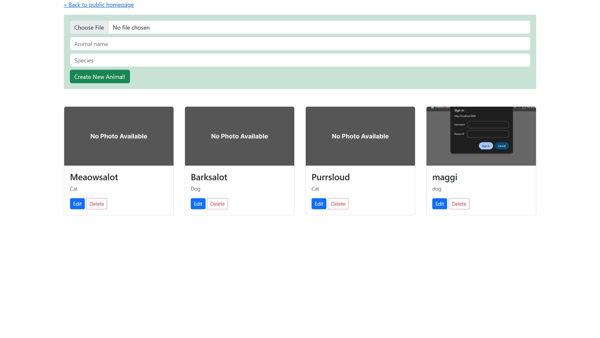

<div align="center">

# 🐾 MERN Animals App

A MERN app to create animal cards with photo uploads.

<a href="https://github.com/miladmo68/MERN-APP"></a>
<a href="https://miladweb.com"></a>

</div>

<p align="center">
  
</p>

## ✨ Features

- Create animal entries with photos
- Uploads with Multer
- Express and MongoDB backend

## 🛠️ Tech Stack

    

> [!NOTE]
> This project needs its own backend, database or API keys, so it runs locally rather than as a static demo.

## 🚀 Getting Started

**Prerequisites:** [Node.js](https://nodejs.org/) 18 or newer · A MongoDB database (local or MongoDB Atlas)

**Install and run**

```bash
git clone https://github.com/miladmo68/MERN-APP.git
cd MERN-APP
npm install
npm run server   # starts the mock API (json-server)
npm run dev      # in a second terminal
```

## 📁 Project Structure

```
MERN-APP/
├── db/
├── public/
├── src/
├── views/
├── docker-compose.yml
├── package.json
├── server-compiled.js
├── server-compiled.js.LICENSE.txt
├── server.js
└── webpack.config.js
```

## 👤 Author

**Milad Mohammadi** — Frontend-Focused Full-Stack Developer, Toronto 🇨🇦

[](https://miladweb.com)
[](https://www.linkedin.com/in/miladmo68/)
[](https://github.com/miladmo68)

<p align="center"><sub>If you like this project, consider giving it a ⭐</sub></p>
